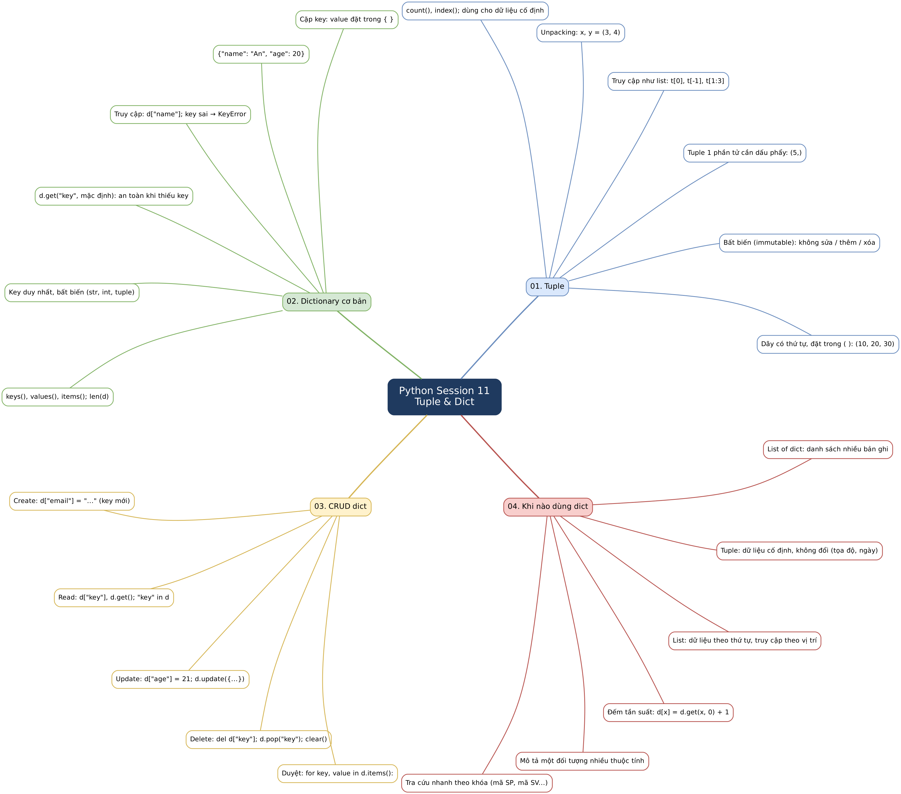

# Mindmap Python Session 11 - Tuple & Dict

Sơ đồ tư duy tổng hợp kiến thức Session 11 của khóa Python: **Tuple**, **Dictionary** cơ bản, các thao tác **CRUD** trên dict và **khi nào nên dùng dict** (so sánh với List, Tuple).

🔗 **Link mindmap (draw.io):** [Mở mindmap trên draw.io](https://www.draw.io/#R3ZxZj5tIEMc%2FDZLzsFYfNMejj5l9yEaKks3uY4RNj42Gw4thMrOffqsPMJj2JFq7kXCkJHRDA25%2BlKv%2B1WWHrrLXpyTlDn1w6CpOol0ZZQ5BeZRB39oh5FOSx1l0gC11TPb6exkd9p%2BKmKeqpyyKqtm34mkKw5NYDUZiGHm8sBfLvegQlTyvfmWAvJIc8xKltb7Bz2%2FVvsih7ys%2FHhO5heHMXgqnXG5K2NqJrT%2FrA3xMcQEvyg7QAdvrZKvPd6zeUt5cpM5jLq6I4agf%2B6TiXw%2FRVuz9AZ8c%2BvZVlurdMHfpqkiLUo6l%2BIlG7En0F3nV6X%2BSf6D%2FWJXFM7804mvyr7gM3KRu67vC8nbl5%2BZlxV8vTh%2FuPiZeZLwq3%2BAQPcD3XTXkTbeZr9o%2Fkrjaqz5Cdd%2BeJ7u9Pq1PVF90VO1de%2BrTw4IN%2FbzMzy5FgyeH8Bw69IO54VOIIx48bU2z7W0DvjmbbczszDZGDPWmmzF3MN0hG8429a6fbd5Md2dKeR4vyrL4Aa28yKFzua3Ll3aOL0%2BW2vO3vmvaTg%2BPd%2Fz9yYHrF3W55eevbxWVO151wRhOY8nTqEpe%2Ble4jsDvQwbXzoo6CyouuBWbSypub%2B88YGe5dBahaOnGEu5hJSzIynVCLDsXztKvxCFlke%2Fg%2Fxn8%2FeDQhdjESB1O9P8U9tyS8ss2xUg5vRHVDM7UpdrzwqERCV1rWH%2B3Bjb532A3L1sf6%2B8jgo0HYC81oAsmAN0kDa%2BP4gtylmRZXUWblGtan%2FcSfldSfGzoX0fyC%2FNRvRLiRVlkbc%2Brel2ie4DapUEPatfzBlBTiu1BjScDNR4PajKAunHisLj9fUO4n3es9GItTXl3V9y%2BCnVvXPimTTV8Ca%2FuwjjThlvNMQnY0Dgzez5H88gmwDEZj2M65Lis37qYrg8i5gIT6zlLuF2UJsdKsVk5DHrYWvkQovUb7jVhEhdU9kwfXzDEPXyxiw34Env40sngS8fD1x3g%2By0HkJ4TcBYko6%2BKRnF9uR%2FNqOpx78Kooib8bZyDYRiHA88elO5koHTHg5INoNwCWdXsgyIPRCv%2BCg0p88TSUw2lb7vdF61HAM7CozS2uhX4dWuUlyLE68V6sH8JJnr6QAeozzMaurqI2sOZTQZnNhbOw%2BgNkbnWJ0HRjEotT3jOQkC5adwGmt9WN2M8iF3TjAdkI1zLUXQz5vXxZIHJ3vq2AL0%2BEmsny7JuNlokhg262arVv4Tr%2Bsx1KKWOeFcjc%2Fyl%2FHcsj9XI7o1MKQvCvsMaDP1VbC3cwjfQwi7AeoUtxSZUx9PCsEELk8h5%2F9QiT7WUqa22pbA9tRd5Z5%2BSe9t2tBsMvBeQXdJXdQNDZggReyDjyYA8otUlv6IbSAxjEAIuEg7agHSDhZGGjxglAuoH4kDMEorzf%2BRvDzDT5R1gTLDf17%2BQwSCH2B7HZDIck%2FE4Hupf8RxuZXZiVKLZN7tZ6zxsTXGYzltEUvotZG4C5TKRkchsxSnfUTfoT57uM3GXNrpEN3Ijnj246WTgpuPBPVTHPko7G0tLne%2B7abhVN3gz5uVgXhoBQx9fiZTHh3ugtx%2FVGTJsxA%2FtwetOBl53PHiHKhpYymMjosnutgWEZcdGUkt5Povvgcr%2BEh3fN%2BTLKLVHJZsMlaOJYUOvF1Ehhq2%2BfBO5hfjWa%2FYAOrI1rhaLvY3HRlK9PNxfgRCGQ%2FuIqbUI7Hq%2FtZ0sy6rXaH4rMaleJY8qboq5eBYlaT%2FoarJhp975fN51c9FMhWRZk3FYJmOZVCPaN1si1ifZoN8SD1kj%2BQai2AWWr7CpxETyeKIYMYhiX3gUm0jux2LNUgMVselv%2F4uBG7it8nx3ADHqU4yxb5AS3NAexngyGOPxMB46B98O8QWT3JdrOwaZYJ0Xntdy8Az0YWGa%2FfU9mN9znxZTd6gTtAvDbJBLJkPuiM7EUARb85S35PL054ZYQ3soDpekM22ftymPytk9wEy9swSb6xlEL4TtwUwnAzMdD%2Bah6LUGuatZRaOXLj6JlIKSXled1LByEeatnLC4A0wZ66fPMKOmlYsWnV53MpiOJm8NLS5yhZDwUaYIcpUzKM7Wh91eXgi23CwvbALmMjRWMdqZP2vUF4LAFqDXW9F2tizrC6NZUWrQF%2F4so84KxEVYyxRCJJYdQk6LF6dKHVF3g2aZql4Txa%2Bfm7RZ2%2FMX%2BLRj%2BQBGlm%2B2XhGfGVdmWLKIrWlj9AaKwgV6rzCu1MTueIoCNSgKn1QNWVuMs1AgtvJWWJ1nckMss7W67kFTT6UhzvftslxcS%2Fzr9jxbNQhAX4%2B2Itcm4RiKQ88QR6b0mGcPcTwZxPF4iA%2FVBkkvanO2WZd1WWt2rDv53VaUeO3KD0pK00UToigYnv1SFbVNn2Ryrpu5piU4PrJHMpkMyWQ8koe%2B8B9tidl7xRDa6Xi%2FIL4yVbPpkS%2Ftmh15oDLa9wA6pf0FDZh4rsErYfZAp5MBfUSf2r1QM%2FxT0n9W9rM6r5LvOzJMODKz5s0IVOV874hQnQPGysDz7R5ccyic7xdrYGTI9rUCtI23wJ3MWzCe8GFY1yPNPUHFU6NxqBdChZZHiSTe7g1%2Bd6%2FYCO2EdjJ9bNnZarQgQIYcdWiPWjYZai2t%2B4Hm6XfD5L7znxWDzub3yE4H6d8q%2Bw8%3D)



## Tóm tắt kiến thức

### Lesson 01: Tuple

- Tuple là dãy **có thứ tự**, đặt trong dấu ngoặc tròn `( )`.
- Tuple **bất biến (immutable)**: không sửa, thêm hay xóa phần tử sau khi tạo. Gán `t[0] = ...` sẽ báo `TypeError`.
- Tuple 1 phần tử **bắt buộc có dấu phẩy**: `(5,)` là tuple, còn `(5)` chỉ là số nguyên.
- Truy cập, slicing giống list; **unpacking** để gán nhiều biến cùng lúc.

```python
point = (10, 20, 30)
print(point[0], point[-1], point[1:3], len(point))   # 10 30 (20, 30) 3

print(type((5,)).__name__, type((5)).__name__)        # tuple int

x, y = (3, 4)                    # unpacking
print(x, y)                      # 3 4

print((1, 2, 2, 3).count(2))     # 2
print((1, 2, 2, 3).index(3))     # 3

point[0] = 99   # TypeError: 'tuple' object does not support item assignment
```

### Lesson 02: Dictionary cơ bản

- Dict lưu dữ liệu dạng cặp **`key: value`**, đặt trong `{ }`.
- Truy cập bằng **key** (không phải chỉ số): `d["name"]`. Key không tồn tại sẽ báo `KeyError`.
- `d.get(key)` trả về `None` (hoặc giá trị mặc định) khi thiếu key, không lỗi.
- **Key là duy nhất** và phải là kiểu bất biến (`str`, `int`, `tuple`); value là kiểu bất kỳ.

```python
student = {"name": "An", "age": 20, "major": "IT"}
print(student["name"])                    # An
print(student.get("email"))               # None
print(student.get("email", "chưa có"))    # chưa có
print(list(student.keys()))               # ['name', 'age', 'major']
print(list(student.values()))             # ['An', 20, 'IT']
print(len(student))                       # 3
```

### Lesson 03: CRUD dict

| Thao tác | Cú pháp | Ghi chú |
|---|---|---|
| **Create** (thêm) | `d["email"] = "an@gmail.com"` | Key chưa có thì thêm mới |
| **Read** (đọc) | `d["key"]`, `d.get("key")`, `"key" in d` | `in` kiểm tra key có tồn tại |
| **Update** (sửa) | `d["age"] = 21`, `d.update({"major": "AI"})` | Key đã có thì ghi đè giá trị |
| **Delete** (xóa) | `del d["key"]`, `d.pop("key")`, `d.clear()` | `pop` trả về giá trị vừa xóa |
| Duyệt | `for key, value in d.items():` | Lấy cả key và value |

```python
student["email"] = "an@gmail.com"     # Create
student["age"] = 21                   # Update
student.update({"major": "AI"})       # Update nhiều key
print("email" in student)             # True
del student["email"]                  # Delete
removed = student.pop("major")        # removed = 'AI'
for key, value in student.items():
    print(f"{key}: {value}")          # name: An / age: 21
```

> Cùng một cú pháp `d[key] = value`: nếu key **chưa có** thì là **thêm**, nếu **đã có** thì là **sửa**.

### Lesson 04: Khi nào dùng dict

| Cấu trúc | Dùng khi | Ví dụ |
|---|---|---|
| **List** | Dữ liệu theo thứ tự, truy cập theo vị trí, hay thêm / xóa | Danh sách đơn hàng, playlist |
| **Tuple** | Dữ liệu cố định, không được thay đổi | Tọa độ `(x, y)`, ngày `(20, 11, 2026)` |
| **Dict** | Tra cứu nhanh theo **khóa**, mô tả đối tượng nhiều thuộc tính | Sản phẩm theo mã, thông tin sinh viên |

Các mẫu dùng dict phổ biến:

```python
# Tra cứu theo mã
products = {"P001": "iPhone 15", "P002": "Ốp lưng"}
print(products["P002"])                       # Ốp lưng

# Đếm tần suất
counts = {}
for fruit in ["táo", "cam", "táo", "xoài", "táo"]:
    counts[fruit] = counts.get(fruit, 0) + 1
print(counts)                                 # {'táo': 3, 'cam': 1, 'xoài': 1}

# List of dict: nhiều bản ghi
students = [
    {"id": "SV01", "name": "An"},
    {"id": "SV02", "name": "Bình"},
]
```
